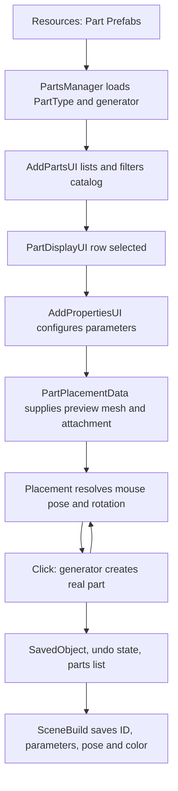

# Adding parts in Protobot

This is a source walkthrough of adding objects in Protobot's build editor, including the Unity authoring work needed to extend its catalog. The production scene is [Main.unity](Assets/Scenes/Main.unity). The application editor runs through the same scripts in Unity Play Mode and in the desktop player; the catalog is authored as Unity prefab assets.

## The main flow

Catalog definitions, placement previews and placed parts have separate lifetimes:

The final loop is intentional: a catalog click places one object and leaves the preview running for another. Selecting a catalog row starts placement; it does not instantiate the finished part immediately.

| Responsibility | Source |
| --- | --- |
| Catalog discovery and generation by saved ID | [PartsManager.cs](<Assets/Scripts/Part Management/PartsManager.cs>) |
| Catalog identity/category/icon | [PartType.cs](<Assets/Scripts/Part Management/PartType.cs>) |
| Parameters, mesh factory and object factory | [PartGenerator.cs](<Assets/Scripts/Part Management/PartGenerator.cs>) |
| Per-variant authoring metadata | [PartData.cs](<Assets/Scripts/Part Management/PartData.cs>) |
| Catalog list and row events | [AddPartsUI.cs](<Assets/Scripts/UI/Add Menu UIs/AddPartsUI.cs>), [PartDisplayUI.cs](<Assets/Scripts/UI/Add Menu UIs/PartDisplayUI.cs>) |
| Add/edit property panel and P shortcut | [AddPropertiesUI.cs](<Assets/Scripts/UI/Add Menu UIs/AddPropertiesUI.cs>) |
| Preview state, rule dispatch and placement commit | [Placement.cs](Assets/Scripts/Placement/Placement.cs), [PartPlacementData.cs](Assets/Scripts/Placement/PartPlacementData.cs) |

## Ways objects enter the build

| Entry point | Behavior and implementation |
| --- | --- |
| Select a catalog row | `AddPropertiesUI.UpdateDisplay` creates `PartPlacementData` and calls `Placement.StartPlacing`. Click repeatedly stamps the current variant. Ordinary catalog placement does not select each newly created object. |
| P with a selection | `AddPropertiesUI.PickPart` freezes the selected bodies through `SelectionPlacementData.Capture`. Click repeatedly stamps the entire set, preserving its geometry, colors and relative poses. |
| Command+C / Command+V | `BuildTransferTool` captures selected parts into the OS clipboard and reconstructs them as one-shot placement. Click places and selects the new set. Windows/Linux defaults use Control. |
| File → Import Build… | `BuildTransferTool` reads a project or selection `.pbb` into one-shot placement without replacing the open project. Click places and selects the set. |
| I / File → Import Model | `CustomModelTool` reads OBJ/STL, creates a selected custom body at the camera focus, and records its addition. Use G/R to position it afterward. This route creates the body directly rather than starting catalog placement. |
| Hold Duplicate, default Alt, when starting a drag or G/R | `ObjectDuplicator` leaves copies at the starting pose while the selected originals move. Commit/cancel belongs to the movement operation. |
| Open a project | `SceneBuild.GenerateBuild` replaces the build and reconstructs its saved objects. This is a load operation, separate from additive import. |

P and file/clipboard transfers use [SelectionPlacementData.cs](Assets/Scripts/Placement/SelectionPlacementData.cs). Existing-part Move also uses `Placement`, with [GameObjectPlacementData.cs](Assets/Scripts/Placement/GameObjectPlacementData.cs), but moves existing geometry instead of adding an object.

## Catalog discovery and presentation

[PartsManager.LoadPartTypes](<Assets/Scripts/Part Management/PartsManager.cs>) runs at runtime initialization. It calls `Resources.LoadAll("Part Prefabs")`, gets a root `PartType` from each returned GameObject, and initializes its `PartGenerator` parameters. Catalog assets live under [Assets/Resources/Part Prefabs](<Assets/Resources/Part Prefabs>). Every loaded definition is expected to have both components; there is no separate registration list to update for an ordinary new type.

The numbered asset subfolders organize the project. UI categories come from `PartType.group`, whose values are `Structure`, `Motion`, `Electronics` and `None`; folder names such as `3Pneumatics` do not create additional UI categories.

`AddPartsUI` builds rows dynamically using its serialized row prefab. Each row shows the definition GameObject's name and `PartType.icon`. Selecting its toggle raises `PartDisplayUI.OnChangeSelected`, which `AddPropertiesUI` subscribes to. Main wires deselecting the last catalog row to `Placement.StopPlacing`, and stopping placement back to catalog deselection.

Search is case-insensitive and compares the query with the definition's name using substring checks in either direction. It does not search saved IDs or individual parameter values. Search excludes `PartGroup.None`. Category browsing filters by the enum name. Both results then pass through [GameElementPreferences.IsVisible](Assets/Scripts/Settings/GameElementPreferences.cs). That method hides specific older game-element IDs according to Preferences while leaving their definitions registered, so saved builds can still load them.

## Definitions, variants and saved identity

`PartType` identifies a family; `PartGenerator` chooses or creates its current geometry; `PartData` describes an authored variant or source template.

| Data | Contract |
| --- | --- |
| `PartType.id` | Stable family ID, for example `CCHL`, `PLTE` or `SHFT`. `GetPartType` resolves the first token of a saved ID against this field. |
| `PartType.connectingPart` | Tells build loading/import staging to generate these parts after the other bodies. Runtime attachment/grouping still requires components such as `Screw`, `Shaft` and `HoleDetector`. |
| `PartType.group`, `icon` | Control catalog categorization and row artwork. |
| `PartGenerator.param1`, `param2` | Up to two ordered parameters. A nonempty parameter name enables it. Parameters can use discrete options or custom numeric values, units, defaults and limits. |
| `PartData.param1Value`, `param2Value` | Match a `ChildPartGenerator` variant to the current parameter values. |
| `PartData.primaryHole` | Mechanical/shaft reference used by specialized placement rules. `PrimaryHoleDepth` reads its collider transform so it matches generated geometry. |
| `PartData.placementHole` | Optional mounting reference for initial catalog placement, independent of `primaryHole`. |
| `PartData.flipPlacement` | Reverses the initial placement orientation and mounting face for that variant. Aluminum generators have their own family-level flag. |
| `PartData.allowCenterInserts` | Enables the existing insert offset behavior when placing a compatible part along a normal shaft. |

`PartGenerator.GetId()` produces `TYPE`, `TYPE-param1` or `TYPE-param1-param2`. Examples are `BRAN`, `CCHL-1x2-5`, `PLTE-3-3` and `SHFT-Normal-6`. `SetId()` adds or updates the generated root's `SavedObject` and captures its default material colors. Call it after the body renderers and their final default materials are ready; see [Body materials and default colors](#body-materials-and-default-colors).

Hyphens are delimiters, not escaped text: do not put them in new family IDs or parameter values. Keep IDs and existing option spellings stable because build files store them. There are explicit legacy conversions in `PartsManager.GeneratePart`, including old wheel, motor, bearing, cylinder, ring and nut forms. A rename can require a migration there rather than just changing a display name.

Catalog generators are shared loaded definitions, not one generator per placed object. `PartsManager.GeneratePart(id, pose)` temporarily applies the ID's parameter values, generates the object, then restores the previous values. New factory code should preserve this separation.

## Generator implementations and parameter changes

Every generator provides two separate outputs: `GetMesh()` for the preview and `Generate(position, rotation)` for a real object. Their geometry must agree in generated-part coordinates. The real factory must supply colliders, holes, materials and other runtime components; a valid preview alone is insufficient.

| Generator | Geometry strategy | Existing authoring example |
| --- | --- | --- |
| [SinglePartGenerator](<Assets/Scripts/Part Management/SinglePartGenerator.cs>) | Reads the referenced `singleObj` root mesh and instantiates that object. Normally has no parameters. | [Brain.prefab](<Assets/Resources/Part Prefabs/2Electronics/Brain.prefab>) |
| [ChildPartGenerator](<Assets/Scripts/Part Management/ChildPartGenerator.cs>) | Finds a child `PartData` with matching parameter values, then reads/instantiates that child. Second-parameter options depend on the first. | [Screw.prefab](<Assets/Resources/Part Prefabs/5Structure/Screw.prefab>) |
| [AluminumPartGenerator](<Assets/Scripts/Part Management/AluminumPartGenerator.cs>) | Chooses a profile's `AluminumSubParts`, combines segment meshes at half-inch intervals, and copies the matching segment holes. Adds name/weight metadata. | [C-Channel.prefab](<Assets/Resources/Part Prefabs/5Structure/C-Channel.prefab>) |
| [PlatePartGenerator](<Assets/Scripts/Part Management/PlatePartGenerator.cs>) | Builds a centered two-dimensional grid of template meshes and holes at half-inch spacing. | [Plate.prefab](<Assets/Resources/Part Prefabs/5Structure/Plate.prefab>) |
| [ShaftPartGenerator](<Assets/Scripts/Part Management/ShaftPartGenerator.cs>) | Scales a normal/high-strength shaft template along local Z; builds equivalent preview vertices. | [Shaft.prefab](<Assets/Resources/Part Prefabs/4Motion/Shaft.prefab>) |

Single/child generators expect a `MeshFilter` on the referenced body itself. Catalog preview uses `PartPlacementData.GetDisplayMesh()` and `CombineSubmeshes`, which reads mesh arrays and reduces them to one submesh. Imported source meshes therefore need Read/Write enabled. Catalog preview does not automatically gather arbitrary nested meshes; the set-copy/Move preview uses `MeshCombiner` for that case.

[ParamDisplay.cs](Assets/Scripts/ParamDisplay.cs) switches between a dropdown and numeric input. Its events call `AddPropertiesUI.UpdateParam1/2`. [PartParameterEditing.cs](<Assets/Scripts/Part Management/PartParameterEditing.cs>) normalizes options, clamps custom limits, rounds `Holes` values, and handles dependent shaft limits: normal shafts reach 12 inches, high-strength shafts 24. Although `ParamDisplay` has its own end-edit clamping, valid numeric edits also reach this shared normalization while typing.

Up/Down step the first parameter; Right/Left step the second. The initial repeat delay is 0.4 seconds, then 0.12 seconds. Discrete options advance within their bounds; custom values step by one hole or 0.5 for other units. Scrolling a `ParamDisplay` is a separate path and steps custom values by one. Shortcuts yield to text editing, rebinding, camera movement, modal transforms and placement rotation.

During catalog placement, changes call `Placement.RefreshPartPreview()`, rebuilding both the mesh and attachment description. When one placed catalog body or one of its holes is selected, the same panel instead regenerates that part through `PartParameterEditing.Replace`. Replacement preserves pose, saved state and connection identity, keeps the nearest surviving selected hole at its original position, refreshes fastener overlaps, and records replacement/selection in one undo step. Parts using their original colors adopt the new variant's defaults; painted parts retain their whole-body tint, and legacy first-material tints remain supported. Multi-selection has no shared parameter editing.

## Body materials and default colors

Author each variant's intended colors and alpha on its body materials. [PartColors.cs](<Assets/Scripts/Part Management/PartColors.cs>) paints all eligible material slots on root or nested `MeshRenderer` objects with a `MeshFilter` and mesh. Materials need a `_BaseColor` or `_Color` property. The renderer's nearest `SavedObject` must be its owning body; hole and mounting-marker renderers are excluded by their layer and hole components.

`PartGenerator.SetId` uses [OwnedPartMaterials.CaptureDefaults](<Assets/Scripts/Part Management/OwnedPartMaterials.cs>) to capture each body renderer/slot's original RGBA color on the first call. A procedural factory must finish creating its body meshes, renderers, material slots and default colors before calling `SetId`, and apply any saved/user tint afterward. The cached palette is retained on later capture calls, so adding slots or assigning defaults after `SetId` leaves an incomplete or incorrect palette. Existing single/child generators capture the referenced template's materials automatically.

The Color tool's Default option restores that palette and clears `SavedObject.hasPaint`. Painting changes RGB while preserving each slot's alpha, shader and texture; a reset restores the original slot colors, including differently colored tires, rollers and housings. The captured colors survive runtime duplication, while load/import reconstructs the palette from freshly generated geometry before applying stored colors. `CustomModel.Create` captures its body palette after building its geometry.

## Preview, snapping and placement rules

`Placement` lives on Main's `Placement` object alongside `AddPropertiesUI`. Keeping property input there allows shortcuts to work while the add-menu visuals are hidden. `StartPlacing` ends custom-model modes and simulation previews, releases the previous preview, installs a combined preview mesh and resets rotation state. The preview is not a `SavedObject`, so it is not a placed build part.

Each update tries Main's serialized `placePositions` list in order; the first rule returning a displacement wins. The production order is:

| Order | Rule | Main purpose |
| --- | --- | --- |
| 1 | `ShaftAxisPlaceDisplacement` | Place compatible bores/motion parts along a hovered shaft, including nearby mating-hole and insert offsets. |
| 2 | `ScrewPlaceDisplacement` | Place `SCRW`/`RBMP` types at the current hole face. |
| 3 | `ShaftPlaceDisplacement` | Place `SHFT` through a hole or into a motor socket using shaft length/type. |
| 4 | `HolePlaceDisplacement` | Align an existing selected hole or an explicitly hole-anchored copied set to a hole/screw target. |
| 5 | `NutPlaceDisplacement` | Place `NUT` at the endpoint of a hovered `Screw`. |
| 6 | `StandoffPlaceDisplacement` | Apply hole/screw offsets for `SNDF`, `SPCR`, `PSPC`, `BRNG` and `WSHR`. |
| 7 | `InsertsPlaceDisplacement` | Place `PLSI`/`MESI` at high-strength holes. |
| 8 | `PartHolePlaceDisplacement` | General catalog-part mounting-hole alignment. |
| 9 | `GearPlaceDisplacement` | Use `SimulationPart` geometry for compatible gear/rack mechanical alignment. |
| 10 | `PlanePlaceDisplacement` | Fall back to the plane collider sampled by `PlaneCast`. |

The rule implementations are in [Assets/Scripts/Placement](Assets/Scripts/Placement), with [GearPlaceDisplacement.cs](Assets/Scripts/Simulation/GearPlaceDisplacement.cs) under Simulation. The serialized list, not component or filename order, establishes priority. New hardware IDs/tags may need rule changes; catalog registration by itself does not grant specialized behavior.

For ordinary hole placement, `PartGenerator.TryGetPlacementHole` takes `placementHole` when assigned, otherwise `primaryHole`. If the chosen reference is absent or belongs to a different variant, it searches for the closest owned hole instead. Plate/aluminum generators override this calculation to account for their generated offsets and even hole counts. `PartPlacementData.RefreshAttachment` caches that local pose, depth and initial flip. `PartHolePlaceDisplacement.Align` places the source's mating face against the target face using `MoveTargeting`; it does not just put the two object origins together. A catalog part without a source hole uses its origin at the target face.

Flat-bearing catalog placement uses the shared face alignment even though the earlier `StandoffPlaceDisplacement` rule handles it: hole-center offsets and bore depth determine its contact with a hole or screw-stack endpoint. Its rotation pivot is that contact face. Block bearings author `placementHole` on their paired mounting side while retaining the perpendicular shaft bore as `primaryHole`. Hex nut retainers author their central mounting hole and `flipPlacement` so the nut pocket faces outward.

Only free-plane placement is quantized by `Placement` to the shared 0.5-inch grid, using world zero for new parts. Holding Snap Bypass, default Control, disables that quantization; exact hole/shaft alignment is not rounded to the grid. Space follows touching, coaxial holes to the outside of the stack, stopping at gaps or misalignment and excluding moving/deleted geometry. Hover markers and catalog/hardware/Move/P/GH placement share this face through `MoveTargeting.ForHole`; G/H source picking limits traversal to the moving selection. P/import/paste sets only use `HolePlaceDisplacement` when they carry an explicit source-hole anchor; otherwise they use the plane/grid, bypassing hardware and gear inference.

R starts rotation about the attachment axis/mating point, or the nearest camera-facing world axis through the preview when no target is locked. [MoveRotation.cs](Assets/Scripts/Tools/MoveRotation.cs) provides circular mouse rotation, 15-degree snapping, retained twist and slash-based exact relative/global angle entry. R again resumes positioning. The displayed pose eases toward the target; committing uses `currentDisplacement`, the resolved target pose. Click confirmation is rejected on the frame placement starts, over UI, during a held camera gesture, or while exact-entry input owns confirmation.

## Commit, undo and persistence

For a catalog click, `Placement.Place` calls the current generator's `Generate` with the resolved world pose. It recalculates the parts list, records an `ObjectElement` with `existing = false` in the previous state, then adds the real object as the next state. [ObjectElement.cs](Assets/Scripts/StateSystem/ObjectElement.cs) implements existence through activation and the `Deleted` layer, so undo hides the object and redo restores it. Calling a generator directly does not automatically add undo history, update the parts list or select its result; the caller owns those steps.

Escape uses the universal [EscapeDeselect](Assets/Scripts/Input/EscapeDeselect.cs) handler: it cancels the preview synchronously through `Placement.CancelPlacement`, leaving the selection and toolbar tool for later Escape presses. The separately rebindable Stop Placing action still stops placement through `StopPlacing`. Stopping catalog placement ends rotation and clears the catalog row via Main's serialized events; already stamped objects remain. Ordinary catalog stopping finishes at the end of the frame; copied-set stopping is synchronous so inactive templates are released immediately. Canceling an uncommitted catalog/set preview adds no finished parts. `Placement` owns and releases the generated preview mesh when it is replaced or destroyed.

[SceneBuild.cs](Assets/Scripts/Builds/SceneBuild.cs) enumerates active `SavedObject` roots. Catalog snapshots store the full generator ID, state, connection ID, world position/rotation and body material color in [ObjectData.cs](Assets/Scripts/Builds/ObjectData.cs). Optional `hasPaint` marks a whole-body paint tint; loading applies it to every body material slot through [PartColors.cs](<Assets/Scripts/Part Management/PartColors.cs>), retaining each material's transparency, texture and shader. Legacy records with color data restore their first body material's RGB while preserving its generated alpha. Nested body renderers are supported without a root renderer; hole and mounting-marker geometry is excluded. Colors and paint metadata participate in dirty-state comparison, including Default restoration in older color-capable builds; versions without RGB data remain clean on load. Catalog meshes and generic transform scale are not embedded: loading reconstructs geometry through `PartsManager.GeneratePart`, so dimensions belong in parameters or authored geometry. Shaft length, for example, is reconstructed from its ID.

Load and import staging generate ordinary/custom bodies before types marked `connectingPart` and restore saved identities/state/colors. Load reconstructs chains after generation; imported chains are recreated when the set is committed. `SavedObject.ConnectionId` is distinct from the family/variant ID: it identifies one placed instance for chain membership. Replacements retain that identity; copies get new identities. P and transfer placement also remap complete chains to their new endpoints. File I/O and native dialogs are owned by `BuildsManager`/`NativeFileDialogs`, not by the part generators.

[PartName.cs](<Assets/Scripts/Parts List/PartName.cs>) supplies parts-list names and weight in grams. [PartListOutput.cs](<Assets/Scripts/Parts List/PartListOutput.cs>) enumerates these components and converts weight to pounds. A saved/rendered object with no `PartName` will be missing from that report.

## Authoring a new catalog part in Unity

1. Open Main and choose the closest existing generator/template above. Create the definition prefab under `Assets/Resources/Part Prefabs`, with exactly one intended root `PartType` and a compatible `PartGenerator`. Give it a unique stable ID, display name, category and sprite. Preserve all new asset `.meta` files. Re-enter Play Mode to reload the catalog.
2. Set parameter names/defaults/limits or the discrete variant values. With `ChildPartGenerator`, every exposed combination must resolve to a child `PartData`; its children must be discoverable by `GetComponentsInChildren<PartData>()`. A missing combination throws instead of generating a fallback part. Do not rely on a second parameter when the first is disabled.
3. Author geometry in inches, with matching preview and generated-body origins/orientations. Supply the body renderer/material, readable mesh and physical collider. Single/child generation clones the referenced body, not the catalog root. Procedural generation must create all required runtime components and finalize body renderers/materials before calling `SetId` itself, so the complete default-color palette is captured.
4. Author actual hole children on `HoleCollisions` (layer 11), tagged `HoleCollider`, with a `MeshCollider` and `HoleCollider` component. Keep the owning body as their direct parent: `HoleCollider.Awake` assigns `holeData.part` from that parent. Local Z/forward is the bore axis, XY scale describes size, and Z scale describes depth for ordinary holes. Choose Normal, Threaded or Clamp behavior and `twoSided` as appropriate.
5. Set each variant's owned `primaryHole` and, where needed, separate `placementHole`, flip and insert flags. Both motor variants are an existing example of mounting with a screw hole while keeping a shaft socket as the primary mechanical reference. Test alignment with a rotated target and opposite face, not only at the origin.
6. For a fastener, include its real `ConnectingPart` implementation/detector and appropriate existing tags. Mark `PartType.connectingPart` for generation ordering. For mechanical simulation/gear snapping, configure the variant's `SimulationPart` and owned mechanical hole; see [SimulationSetup.cs](Assets/Editor/SimulationSetup.cs), [MechanismSetup.cs](Assets/Editor/MechanismSetup.cs) and [SimulationPart.cs](Assets/Scripts/Simulation/SimulationPart.cs). Existing setup helpers contain explicit family-ID handling and may need extension for a new family.
7. Give generated bodies correct `PartName`/weight metadata. Check generation by full saved ID as well as by catalog click, then exercise parameters, selection/movement, undo/redo, saving/reopening and copying/importing. Paint each variant, choose Default, and check every body slot's original color/alpha, undo/redo, copied and reloaded parts, and parameter changes to variants with different default colors. A new game-element family may also need an explicit visibility-preference mapping.

`PartData.holeData` is a serialized text field, and [HoleGenerator.cs](Assets/Scripts/Holes/HoleGenerator.cs) contains a text-driven helper. There is currently no project C# caller of `HoleGenerator.CreateHoles`; neither `PartGenerator` nor its concrete factories automatically reads that text. Merely filling the field does not create runtime holes. Existing factories clone authored `HoleCollider` children or generate/copy them explicitly. `RemoveDataScripts` removes the generated root's `PartData`; it does not turn metadata into geometry.

## Custom models and transferred sets

[CustomModelTool.cs](<Assets/Scripts/Part Management/CustomModelTool.cs>) imports OBJ/STL on a worker thread, then creates Unity objects on the main thread. The user selects millimeters, centimeters or inches; [CustomModelImporter.cs](<Assets/Scripts/Part Management/CustomModelImporter.cs>) centers and converts the geometry into inches. The result is one editable-color body with ID `CUSTOM`, root mesh/collider, instance-owned material and embedded geometry. External OBJ materials/textures are omitted. It does not register a new `PartType` or add a reusable catalog row.

M starts repeated surface mounting-point placement with a 0.169-inch diameter and 0.046-inch depth by default; saved holes retain their configured dimensions. [CustomModel.cs](<Assets/Scripts/Part Management/CustomModel.cs>) adds direct child mounting points with ordinary hole ownership and threaded/through behavior. [CustomMountGrid.cs](<Assets/Scripts/Part Management/CustomMountGrid.cs>) leaves the first point on each model plane free, then aligns new points to its 0.25-inch square layout. The initial axes follow the model; the frame follows model movement and reload. In M mode, N (rebindable as Recalibrate Mounting Grid) uses the last-selected hole's position and orientation as that plane's grid reference without moving existing holes. Recalibration is undoable and persists through whole-model copying and save/load; it is unavailable during text entry or a pending transform. Other faces/models keep independent layouts, and the Snap Bypass binding allows arbitrary spacing. A grid position beyond the model bounds is blocked; bypass places on the actual clicked surface. Points annotate attachment locations without cutting the source mesh. Their permanent rings are visible only during M/hole editing; colliders stay active for snapping and fasteners when the rings are hidden. Adding/removing them is undoable, and snapshots embed active committed points so the original OBJ/STL file is unnecessary after saving.

In M mode, clicking an existing ring selects one point; holding Select Multiple (default Ctrl) toggles points into/out of the selection. [CustomMountEditor.cs](<Assets/Scripts/Part Management/CustomMountEditor.cs>) reuses G/R/Delete for the selected points while keeping their models fixed. The last selected point defines the movement plane; R rotates a multi-point pattern about its center. G can cross pre-made holes with no surface ray hit and snaps point movement in 0.25-inch steps; X/Y/Z, Snap Bypass and slash exact entry are available. Hold Duplicate (default Alt) when starting G/R to edit copies of the selected pattern. Click/Enter commits the group as one undo step; Escape cancels, then clears selection, then exits M on subsequent presses. Picking includes hollow centers and respects foreground occlusion. The existing Undo/Redo shortcuts work in M mode with or without selected holes after committing an edit; finish or cancel a pending G/R preview and leave text entry before using build history. Point poses save relative to their owner and restore attachment occupancy on undo/redo. Pending copies have disabled attachment colliders and are excluded from saves; cancellation removes them and restores the original selection. Duplication reuses matching existing holes and selects only newly created points, so adjacent layouts can overlap without adding duplicate colliders. A pattern that adds no holes or conflicts with an existing hole's dimensions/type stays uncommitted.

[BuildTransferTool.cs](Assets/Scripts/Builds/BuildTransferTool.cs) and [BuildTransfer.cs](Assets/Scripts/Builds/BuildTransfer.cs) share selection capture, including latched individual/group scope and any explicit selected-hole face. P freezes live copies; paste/import rebuilds an inactive template set from `BuildData`. `SelectionPlacementData` expresses every template relative to the selected anchor or imported bounds center, builds one preview, and generates independently identified copies on commit. Complete chains are remapped to the copied endpoints; partial chains are omitted. One commit records the entire set and its chains in one undo step. Paste/import stops after that commit and selects only the new roots; P remains repeatable. Escape disposes the templates without placing them.

File → Save Selected Parts As… exports the captured set as `.pbb` through a Save As panel every time. It does not change the open project's save target or saved snapshot. This lets the same set enter another project through Import Build, in addition to cross-project clipboard paste.

[OwnedPartMaterials.cs](<Assets/Scripts/Part Management/OwnedPartMaterials.cs>) tracks ordinary copies' private runtime materials. Build/paste templates instance all renderer slots, including nested wheel geometry; live duplicates explicitly clone their materials. Discarding templates/copies releases only tracked instances, leaving catalog/source materials, textures and shaders intact. The ownership list is not serialized into subsequent clones. The default-color palette stores serialized renderer references and per-slot colors, so Unity remaps its references to each copy's own renderers. Custom models retain their separate geometry/material ownership while sharing default-color capture.

## Where to investigate failures

| Symptom | First places to inspect |
| --- | --- |
| New type does not appear | Resource path, root `PartType`/generator, enum group, display-name search and `GameElementPreferences.IsVisible`. |
| A parameter combination fails | `ChildPartGenerator` child `PartData` values, dependent option lists and `PartParameterEditing.Normalize`. |
| Preview and placed geometry disagree | Factory `GetMesh` versus `Generate`, source root mesh, template transforms and procedural offsets. |
| Hole snap is offset or reversed | Owned `placementHole`/`primaryHole`, hole depth/forward, variant flip and the serialized rule priority. |
| Part looks correct but will not attach | Actual hole/detector colliders, direct ownership, layers/tags, hole type/occupancy and `ConnectingPart` graph refresh. |
| New part disappears or changes on reload | `SetId`, stable ID/parameter parsing, `GeneratePart`, root renderer and dimensions encoded in parameters. |
| Paint misses geometry or Default restores wrong colors | Body `MeshRenderer`/mesh, shader color properties, `SavedObject`/hole ownership, and complete material setup before `SetId` captures defaults. |
| Part is absent from weight/export | Generated `PartName` and weight, followed by parts-list recalculation. |

## Validation entry points

These are existing checks to run when changing the implementation; this document itself does not change runtime behavior. Full invocation/build instructions are in [CONTEXT_MAP.md](CONTEXT_MAP.md#validation-and-build).

| Change area | Relevant existing validation |
| --- | --- |
| Catalog properties, generator parameter isolation, replacement and preview refresh | `InteractionUpdatesValidation.Validate` and `.Smoke` |
| Mounting anchors, generated/even-count holes, rule priority and initial R rotation | `HolePlacementValidation.Validate` and `.Smoke` |
| Fastener ownership/grouping, movement and regeneration | `FastenerGroupingValidation.ValidateRelated`, `GrabHoleSnappingValidation.Smoke` |
| P multi-part placement and template cleanup | `SelectionPlacementValidation.Smoke` |
| Body colors, painting, Default restoration and copied material ownership | `ColorPaintingValidation.Smoke`, `PasteMaterialValidation.Smoke` |
| Additive import, selection export, clipboard, chain identities and save/load | `BuildTransferValidation.Smoke`, `BuildFileValidation.Smoke` |
| OBJ/STL parsing, mounting-point addition/deletion and embedded saves | `CustomModelValidation.Validate` and `.Smoke` |
| Mounting-point plane grids, multi-selection, duplication and pose editing | `CustomMountLayoutValidation.Smoke`, `CustomMountEditingValidation.Smoke` |
| Mechanism metadata/snapping/transmission | `SimulationValidation.Validate`, `.Smoke` and `.MechanismsSmoke` |

The validation sources are under [Assets/Editor](Assets/Editor). Play Mode smoke methods run without `-quit` and exit Unity themselves. For a new family, also exercise its actual prefab/variant combinations; the existing suites do not automatically cover every newly authored asset.
